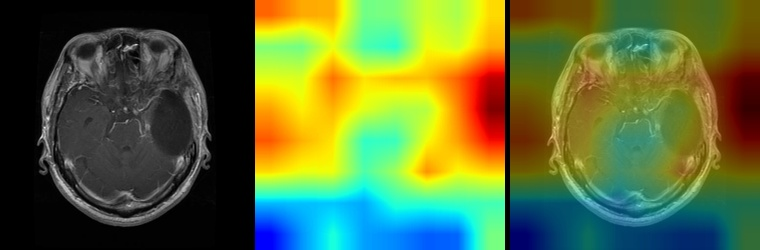
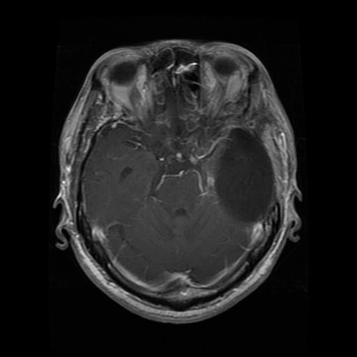
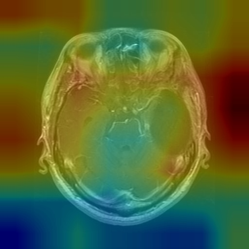
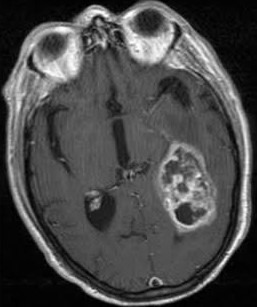
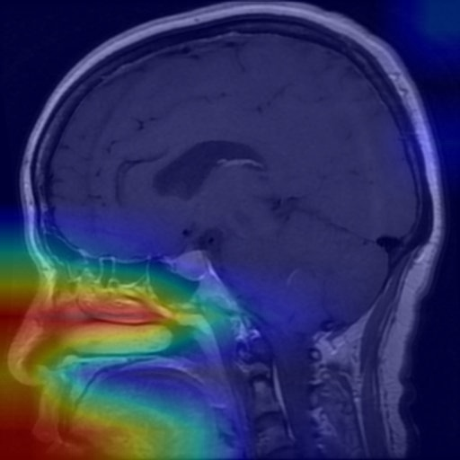
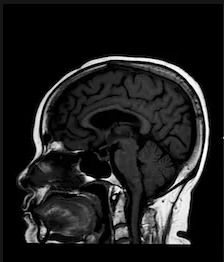
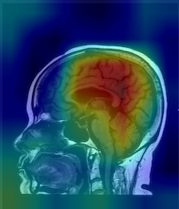

# 🧠 NeuroScan AI — Brain Tumor Detection & Analysis with Grad-CAM

<p align="center">
  
  
  
  
  
  
  
</p>

An end-to-end web application that classifies brain MRI scans into four categories, highlights tumor regions using **Grad-CAM heatmaps**, and provides a patient-friendly **AI Care Assistant** with reliable health information.

---

## 💡 Why We Built This

Most deep learning models for medical imaging are "black boxes" — they take an image, output a prediction like *"Glioma: 97%"*, and give zero indication of how they reached that conclusion. In healthcare, doctors can't just trust a percentage; they need to see *where* the model is looking to confirm it isn't making decisions based on image noise, skull thickness, or hospital watermarks.

We built **NeuroScan AI** to combine:
1. **Accurate Classification:** Fine-tuned VGG16 transfer learning model reaching **90.0% test accuracy**.
2. **Visual Explainability:** Authentic Grad-CAM heatmaps showing the exact brain regions influencing the prediction.
3. **Patient-Centric Guidance:** An AI Care Assistant providing clear, non-technical explanations of tumor types, treatments, and safety precautions based on NCI and WHO guidelines.

---

## 🔬 Visualizing What the Model Sees (Grad-CAM)

When a scan is uploaded, our pipeline computes gradients from the final convolutional layer (`block5_conv3`) to generate a class activation map. This shows where the model placed its attention.

<p align="center">
  
</p>
<p align="center">
  <em>Figure 1: (Left) Original patient axial MRI scan, (Middle) Grad-CAM activation heatmap using the JET colormap, (Right) Heatmap blended onto the MRI scan (&alpha; = 0.42).</em>
</p>

---

## 🖼️ How the Model Behaves Across All 4 Classes

We evaluated the system across four conditions. Here are sample Grad-CAM outputs for each class:

<p align="center">
  
</p>
<p align="center">
  <em>Figure 2: Attention maps across Glioma, Meningioma, Pituitary tumor, and Healthy scans. Notice how the model focuses specifically on the lesion area while keeping attention dispersed on healthy tissue.</em>
</p>

### Class Comparison Summary

| Tumor Category | Raw Scan | Model Attention (Overlay) | What it is in simple terms |
| :--- | :---: | :---: | :--- |
| **Glioma** |  |  | Starts inside the brain tissue itself (glial cells). Tends to have irregular, infiltrative edges that blend into surrounding tissue. |
| **Meningioma** |  |  | Grows on the protective membranes (meninges) covering the brain. Usually non-cancerous, pressing inward on the brain. |
| **Pituitary Tumor** |  |  | Grows in the pituitary gland at the base of the skull. Often causes hormonal imbalances and presses on the optic nerve. |
| **No Tumor (Healthy)** |  |  | Normal brain anatomy with clear, symmetrical ventricles, intact midline, and no abnormal mass or swelling. |

---

## ✨ Features

- **Drag-and-Drop MRI Upload:** Simple, clean web interface to upload any standard MRI image (PNG, JPG, JPEG).
- **3-Way Multi-Modal Viewer:** Seamlessly toggle between the *Original Scan*, *Pure Heatmap*, and *Superimposed Overlay* on the analysis page.
- **Dynamic Probability Breakdown:** Interactive Chart.js bar chart displaying the confidence scores across all four classes.
- **AI Brain Tumor Care Assistant:**
  - Clear explanations of the diagnosed condition.
  - Common treatment options (Surgery, Radiation, Chemotherapy, Targeted Therapy).
  - Daily precautions (anti-seizure guidance, fall prevention, driving safety).
  - Emergency warning signs ("When to call an ambulance").
  - 10 recommended questions to ask your oncologist.
  - Built-in chatbot that works **100% offline** (with optional live Gemini API key support).
- **Model Performance Dashboard:** Live view of the confusion matrix, classification report, and training/validation loss and accuracy curves.

---

## 📊 Results & Performance

We evaluated the model on a strict **holdout test set of 1,600 scans** (400 per class) that were never seen during training:

| Metric | Score | Note |
| :--- | :---: | :--- |
| **Overall Accuracy** | **90.00%** | 1,440 out of 1,600 correct predictions |
| **Weighted Precision** | **89.99%** | High positive prediction reliability |
| **Weighted Recall** | **90.00%** | Crucial for minimizing missed cases (false negatives) |
| **Weighted F1-Score** | **89.83%** | Balanced performance across all four classes |

### Breakdown by Category (Sample Evaluation of 400 Test Images)

| Category | Precision | Recall | F1-Score | Analysis |
| :--- | :---: | :---: | :---: | :--- |
| **Pituitary** | 98.0% | 97.0% | **97.5%** | Highest accuracy due to distinct location in the sella turcica. |
| **No Tumor** | 90.0% | 99.0% | **94.3%** | Almost zero false alarms on healthy scans (99% recall). |
| **Meningioma** | 84.6% | 88.0% | **86.3%** | Good detection of extra-axial membrane tumors. |
| **Glioma** | 87.4% | 76.0% | **81.3%** | Most challenging class; occasionally confused with meningiomas due to fuzzy borders. |

### Confusion Matrix

```text
                        PREDICTED CLASS
                 Pituitary  Glioma  No Tumor  Meningioma
ACTUAL:
Pituitary           97        0        1          2
Glioma               1       76        9         14
No Tumor             0        1       99          0
Meningioma           1       10        1         88
```

> **Honest takeaway:** The primary area of confusion is between **Glioma and Meningioma** (14 gliomas predicted as meningiomas). In clinical practice, distinguishing between an infiltrative glioma and a parasagittal meningioma on a single 2D contrast slice is difficult even for radiologists, which is why real hospitals use multi-planar 3D views and perfusion MRI.

---

## 🛠️ How It Works Under the Hood

### 1. Image Preprocessing Pipeline
1. Scan is uploaded and converted to 3-channel RGB.
2. Bilinearly resized to $128 \times 128$ pixels.
3. Pixel values scaled from $[0, 255]$ to $[0.0, 1.0]$.
4. Tensor reshaped to `(1, 128, 128, 3)` for model inference.

### 2. VGG16 Transfer Learning
- **Base:** VGG16 pre-trained on ImageNet.
- **Frozen Layers:** Blocks 1 through 4 are frozen to retain general low-level edge and texture detectors.
- **Fine-Tuning:** Block 5 is unfrozen and trained with a low learning rate ($1 \times 10^{-4}$) to adapt specifically to brain tissue features.
- **Classifier Head:** Flatten $\rightarrow$ BatchNormalization $\rightarrow$ Dropout(0.3) $\rightarrow$ Dense(256, ReLU) $\rightarrow$ BatchNormalization $\rightarrow$ Dropout(0.2) $\rightarrow$ Dense(4, Softmax).

### 3. Grad-CAM Calculation
1. Extract the activations $A^k$ of the final conv layer (`block5_conv3`).
2. Compute the gradient of the predicted class score $y^c$ with respect to each feature map: $\frac{\partial y^c}{\partial A^k}$.
3. Average the gradients across spatial dimensions to get channel importance weights $\alpha_k^c$.
4. Take a weighted sum of the feature maps and pass through **ReLU** (retaining only features that positively contributed to that class):
   $$L_{\text{Grad-CAM}}^c = \text{ReLU}\left(\sum_{k} \alpha_k^c A^k\right)$$
5. Normalize to $[0, 1]$, upsample to original image size, apply the JET colormap, and blend at $\alpha = 0.42$.

---

## ❓ FAQ: Why do some MRI images downloaded from Google give wrong answers?

If you download a random brain MRI from Google Images, the model might occasionally give an unexpected prediction. Here is why:

1. **Slice Orientation:** Our model was trained exclusively on **axial (horizontal top-down) slices**. Google Images often has **sagittal (side view)** or **coronal (face-on)** slices, which have entirely different anatomy.
2. **MRI Sequence Type:** The dataset uses **T1-weighted contrast-enhanced** scans where fluid is dark and tumors show up bright. If you upload a **T2 or FLAIR** scan, normal fluid in the brain looks bright white, which can trick the model.
3. **Annotations & Watermarks:** Medical websites often add hospital logos, text markers ("L", "R", patient IDs), or white borders. These change the image statistics and confuse convolutional filters.

---

## 📁 Project Structure

```text
brain_tumor/
├── app.py                          # Flask entry point launcher
├── main.py                         # Route definitions and REST API endpoints
├── train.py                        # Model training and fine-tuning script
├── predict.py                      # Quick CLI prediction script
├── models/
│   └── model.h5                    # Trained VGG16 model weights (~64 MB)
├── services/
│   ├── prediction_service.py       # Image loading, preprocessing & model inference
│   ├── gradcam_service.py          # Grad-CAM backprop, JET colormap & overlay blending
│   ├── evaluation_service.py       # Metrics loader & confusion matrix provider
│   └── ai_care_assistant.py        # Clinical knowledge base & offline NLP chatbot
├── templates/
│   ├── base.html                   # Master layout with navbar and footer
│   ├── dashboard.html              # Main dashboard with stats & upload dropzone
│   ├── analysis.html               # Prediction results, Grad-CAM viewer & Chart.js
│   ├── care_assistant.html         # Educational guidance, precautions & chatbot
│   ├── explainable_ai.html         # Grad-CAM deep dive & technical viewer
│   ├── model_performance.html      # Confusion matrix & benchmark graphs
│   └── about.html                  # Model architecture & medical context
├── static/
│   ├── css/
│   │   ├── style.css               # Main dashboard UI stylesheet
│   │   └── care_assistant.css      # Care Assistant layout & chat styles
│   └── js/
│       ├── main.js                 # Drag-and-drop & file validation
│       ├── heatmap.js              # 3-way toggle image viewer
│       ├── charts.js               # Chart.js probability bars & performance graphs
│       └── care_assistant.js       # Chat message handler & quick question chips
├── docs/
│   └── images/                     # Figures used in this README
├── reports/
│   ├── evaluation_metrics.json     # Test cohort metrics & confusion matrix data
│   └── training_history.json       # Epoch-by-epoch loss & accuracy history
├── dataset/                        # Kaggle dataset (Training/ and Testing/)
├── requirements.txt                # Python dependencies
└── VIVA_QUESTIONS_AND_ANSWERS.md   # Top 40 viva questions and answers guide
```

---

## 🚀 Getting Started

### 1. Prerequisites
- Python 3.10 to 3.12 installed.
- VS Code (or your preferred editor).

### 2. Clone the Repository
```bash
git clone https://github.com/genus-lang/brain_tumor.git
cd brain_tumor
```

### 3. Set Up Virtual Environment
```powershell
# Windows (PowerShell)
python -m venv .venv
.\.venv\Scripts\Activate.ps1

# Linux / macOS
python3 -m venv .venv
source .venv/bin/activate
```

### 4. Install Dependencies
```bash
pip install -r requirements.txt
```

### 5. Run the Application
```bash
python app.py
```
Open your browser and navigate to: **`http://127.0.0.1:5000`**

### 6. (Optional) Enable Live Gemini Responses
The AI Care Assistant works completely offline out-of-the-box. If you'd like to enable live AI responses using Google Gemini:
```powershell
# Windows PowerShell
$env:GEMINI_API_KEY="your-gemini-api-key"

# Linux / macOS
export GEMINI_API_KEY="your-gemini-api-key"
```

---

## 🔒 Privacy & Local Processing
- All image processing, neural network inference, and Grad-CAM generation run **100% locally on your machine**.
- No patient scans or personal data are sent to external cloud servers.
- Uploaded files are stored in a local temporary folder (`uploads/`) and can be cleared at any time.

---

## ⚖️ Disclaimer

> **Medical Disclaimer:** NeuroScan AI is an educational and academic research project. The predictions, Grad-CAM visualizations, and Care Assistant outputs provided by this software are for informational and research purposes only. They **do not** constitute a clinical diagnosis, medical advice, or treatment plan. Always consult a qualified physician or neuro-oncologist for professional medical evaluation.
