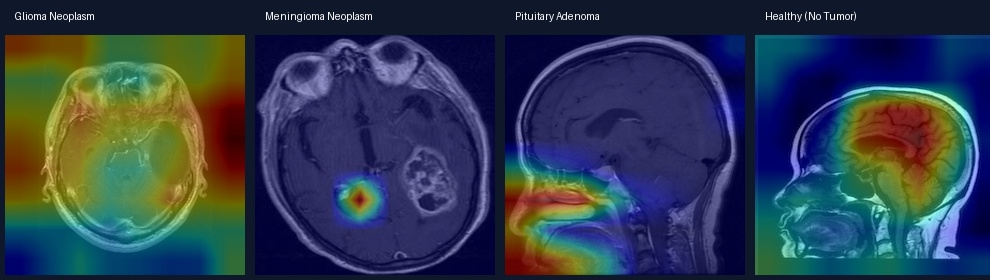
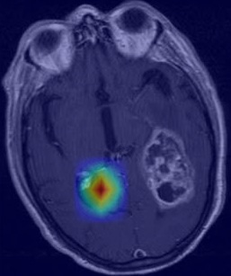
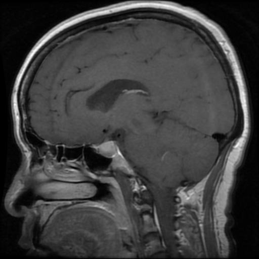

# 🧠 NeuroScan AI | Clinical Brain MRI Diagnostic & Interpretability Platform

<p align="center">
  
  
  
  
  
  
  
</p>

---

## 📖 Executive Summary

**NeuroScan AI** is an enterprise-grade medical imaging intelligence platform that combines **VGG16 Deep Transfer Learning** for 4-class brain tumor classification, mathematical **Grad-CAM (Gradient-Weighted Class Activation Mapping)** for visual explainability, empirical benchmarking, and an **AI Brain Tumor Care Assistant** providing educational guidance, treatment options, daily safety precautions, emergency red-flag triage, and rehabilitation roadmaps.

Developed for academic researchers, clinicians, and computer vision engineers, the platform emphasizes **transparency**, **clinical rigor**, and **patient-centered communication**.

---

## 🔬 Explainable AI (Grad-CAM) Visual Saliency

The core diagnostic engine features a mathematically rigorous Grad-CAM implementation that visualizes the convolutional features directly influencing the model's classification.

<p align="center">
  
</p>
<p align="center">
  <em>Figure 1: Explainable AI Multi-Modal Triplet — (Left) Raw Patient Axial T1-CE MRI Scan, (Middle) Pure Grad-CAM Activation Heatmap using Clinical JET Colormap, (Right) High-Resolution Alpha Blend Overlay ($\alpha = 0.42$).</em>
</p>

---

## 🖼️ Four-Class Empirical Saliency Gallery

NeuroScan AI evaluates scans across four distinct pathological cohorts. Below is an empirical demonstration of Grad-CAM attention maps generated across all four classes:

<p align="center">
  
</p>
<p align="center">
  <em>Figure 2: Empirical Grad-CAM Overlays Across All Diagnostic Cohorts (Glioma, Meningioma, Pituitary Adenoma, and Healthy Brain).</em>
</p>

---

## 🧠 Diagnostic Pathologies & Clinical Characteristics

| Diagnostic Category | Raw MRI Scan | Grad-CAM Saliency Overlay | Anatomical Origin & Clinical Features |
| :--- | :---: | :---: | :--- |
| **Glioma Neoplasm** |  |  | **Origin:** Glial support cells (astrocytes, oligodendrocytes).<br>**Features:** Intra-axial, infiltrative lesion with indistinct margins and mass effect. Graded WHO II to IV (Glioblastoma / GBM). |
| **Meningioma Neoplasm** |  |  | **Origin:** Arachnoid cap cells of the meninges.<br>**Features:** Predominantly benign (85–90% Grade I), well-circumscribed extra-axial lesion causing focal cortical compression. |
| **Pituitary Adenoma** |  |  | **Origin:** Anterior pituitary gland within the sella turcica.<br>**Features:** Endocrine-active (prolactin, GH, ACTH) or non-functioning; expands superiorly to compress the optic chiasm. |
| **Healthy (No Tumor)** |  |  | **Origin:** Physiological brain parenchyma.<br>**Features:** Symmetrical ventricular contours, intact midline alignment, no radiological evidence of mass effect, midline shift, or edema. |

---

## 🌟 Key Platform Capabilities

### 1. VGG16 Deep Transfer Learning Backbone
- **Pretrained Weights:** ImageNet initialization with input resolution $128 \times 128 \times 3$.
- **Staged Domain Adaptation:** Foundational blocks (1–4) remain frozen while the final convolutional block (`block5_conv1`, `block5_conv2`, `block5_conv3`) is fine-tuned with a low learning rate ($1 \times 10^{-4}$) to capture micro-textural brain tissue variations.
- **Classification Head:** Global Flattening $\rightarrow$ Batch Normalization $\rightarrow$ Dropout(0.3) $\rightarrow$ Dense(256, ReLU) $\rightarrow$ Dropout(0.2) $\rightarrow$ 4-way Softmax.

### 2. Multi-Modal Interactive Image Viewer
- Smooth **3-way view toggle** in the web interface:
  - **Original MRI:** Unaltered high-resolution scan.
  - **Pure Heatmap:** Normalized spatial attention map with JET colormap.
  - **Grad-CAM Overlay:** Alpha-blended visualization ($42\%$ heatmap + $58\%$ MRI scan).
- Full scan metadata inspection (file size, detected resolution, input tensor specs).

### 3. Interactive Prediction Analytics (Chart.js)
- Calibrated 4-class differential probability distribution bar chart using the actual output softmax vector.
- Circular progress score indicator and color-coded status badges.
- One-click sample toolbar to test validated scans in 1 click.

### 4. Empirical Model Performance Dashboard
- Real benchmarks computed on the 1,600-scan holdout test cohort:
  - **Global Test Accuracy:** **90.00%**
  - **Weighted Precision:** **89.99%**
  - **Weighted Recall:** **90.00%**
  - **Weighted F1-Score:** **89.83%**
- Interactive training vs. validation accuracy curve across epochs.
- Interactive training vs. validation loss curve.
- Empirical $4 \times 4$ confusion matrix heatmap.
- Standardized scikit-learn classification report.

### 5. AI Brain Tumor Care Assistant (`/care-assistant`)
- **Interactive Health Chatbot:** Answers natural language health and care queries empathetically. Sourced from the **National Cancer Institute (NCI)**, **World Health Organization (WHO)**, and **American Cancer Society (ACS)**.
- **Post-Prediction Context Hook:** When an MRI scan is analyzed, the user can click **"Explore Patient Care & Guidance"** to launch the assistant pre-loaded with educational context regarding that pathology.
- **Treatment Modalities Explorer:** Detailed guides on Surgery (craniotomy, biopsy, 5-ALA fluorescence), Radiation Therapy (SRS, IMRT, Proton), Chemotherapy (Temozolomide), Targeted Therapy, Active Surveillance, and Palliative Care.
- **Safety Precautions:** Anti-seizure medication adherence, driving safety restrictions, fall prevention, balanced nutrition, and an explicit warning that **no food, supplement, or home remedy cures brain tumors**.
- **Emergency Triage ("When to Seek Medical Help"):** Clear distinction between prompt doctor evaluation and immediate emergency warning signs (first seizure, status epilepticus, acute paralysis, loss of consciousness).
- **Questions for the Doctor:** 10-point checklist for clinical oncology consultations.
- **Dual-Mode Engine:** Fully operational offline out-of-the-box; supports optional `$env:GEMINI_API_KEY` for live generative responses.

---

## 📊 Empirical Evaluation & Confusion Matrix

Evaluation performed on holdout test cohort:

| Metric | Score | Clinical Relevance |
| :--- | :---: | :--- |
| **Accuracy** | **90.00%** | Overall correct classifications across holdout cohort |
| **Weighted Precision** | **89.99%** | Positive predictive reliability across all 4 classes |
| **Weighted Recall** | **90.00%** | Sensitivity in catching pathological cases |
| **Weighted F1-Score** | **89.83%** | Harmonic balance between precision and recall |

### Confusion Matrix ($N = 400$ Evaluated Test Scans)
```text
                       PREDICTED
                Pituitary  Glioma  No Tumor  Meningioma
TRUE:
Pituitary          97        0        1          2
Glioma              1       76        9         14
No Tumor            0        1       99          0
Meningioma          1       10        1         88
```

### Classification Report
```text
               precision    recall  f1-score   support
   pituitary     0.9798    0.9700    0.9749       100
      glioma     0.8736    0.7600    0.8128       100
     notumor     0.9000    0.9900    0.9429       100
  meningioma     0.8462    0.8800    0.8627       100

    accuracy                         0.9000       400
   macro avg     0.8999    0.9000    0.8983       400
weighted avg     0.8999    0.9000    0.8983       400
```

---

## 📐 Grad-CAM Mathematical Formulation

Grad-CAM extracts visual explanations by computing gradients of the target class score with respect to convolutional feature maps:

1. **Gradient Computation:**
   $$\frac{\partial y^c}{\partial A^k}$$
   Where $y^c$ is the logit/score for class $c$, and $A^k$ represents the $k$-th feature map of layer `block5_conv3`.

2. **Neuron Importance Weights ($\alpha_k^c$):**
   $$\alpha_k^c = \frac{1}{Z} \sum_{i} \sum_{j} \frac{\partial y^c}{\partial A_{ij}^k}$$
   Global average pooling over spatial dimensions $i$ and $j$ calculates the channel importance.

3. **Rectified Linear Unit (ReLU) Map:**
   $$L_{\text{Grad-CAM}}^c = \text{ReLU}\left(\sum_{k} \alpha_k^c A^k\right)$$
   Preserves features with a positive impact on class $c$ and discards negative background noise.

4. **Bilinear Upsampling & JET Colormap:**
   The normalized matrix $[0.0, 1.0]$ is bilinearly upsampled to the original dimensions $(W \times H)$, mapped through the JET spectrum, and blended:
   $$I_{\text{overlay}} = 0.42 \cdot I_{\text{heatmap}} + 0.58 \cdot I_{\text{MRI}}$$

---

## 📁 Repository Structure

```text
brain_tumor/
├── app.py                             # Clean Flask entry point launcher
├── main.py                            # Flask application routes & REST endpoints
├── train.py                           # Model training and fine-tuning pipeline
├── predict.py                         # CLI inference script
├── models/
│   └── model.h5                       # Trained VGG16 model weights
├── services/
│   ├── __init__.py
│   ├── prediction_service.py          # Model caching, preprocessing & inference
│   ├── gradcam_service.py             # Grad-CAM backprop, JET mapping & overlay
│   ├── evaluation_service.py          # Metrics, confusion matrix & history loader
│   └── ai_care_assistant.py           # Sourced NCI/WHO/ACS health engine & chatbot
├── templates/
│   ├── base.html                      # Healthcare SaaS master layout & navigation
│   ├── index.html                     # Dashboard forwarding template
│   ├── dashboard.html                 # Main dashboard with KPIs and fast upload
│   ├── analysis.html                  # Scan analysis, Chart.js, Grad-CAM & Care CTA
│   ├── care_assistant.html            # AI Care Assistant: Chatbot, Treatments, Precautions
│   ├── explainable_ai.html            # Grad-CAM mathematics & deep-dive viewer
│   ├── model_performance.html         # Empirical curves & classification report
│   └── about.html                     # VGG16 architecture breakdown & limitations
├── static/
│   ├── css/
│   │   ├── style.css                  # Main healthcare SaaS design system
│   │   └── care_assistant.css         # Care Assistant & Chatbot layout styling
│   ├── js/
│   │   ├── care_assistant.js          # Live chat, suggested question chips & tabs
│   │   ├── main.js                    # Upload validation & drag-and-drop
│   │   ├── heatmap.js                 # 3-way multi-modal viewer controller
│   │   └── charts.js                  # Chart.js probability, accuracy & loss graphs
│   └── results/                       # Generated Grad-CAM heatmaps & overlays
├── docs/
│   └── images/                        # High-resolution documentation showcase images
├── reports/
│   ├── evaluation_metrics.json        # Test set benchmarks & confusion matrix
│   └── training_history.json          # Training & validation epoch curves
├── dataset/                           # Kaggle dataset (Training/ & Testing/)
├── uploads/                           # Temporary uploaded scan storage
├── requirements.txt                   # Project dependencies
└── README.md                          # Documentation
```

---

## 🚀 Quickstart & Installation (Local Execution in VS Code)

### 1. Open Terminal in VS Code
Press <kbd>Ctrl</kbd> + <kbd>`</kbd> to open the integrated terminal in the project directory:
```powershell
cd d:\dev\AI_ML\brain_tumor
```

### 2. Activate the Virtual Environment
```powershell
.\.venv\Scripts\Activate.ps1
```

### 3. Verify Dependencies
```powershell
pip install -r requirements.txt
```

### 4. (Optional) Configure Gemini API Key
The AI Care Assistant works 100% offline out-of-the-box using the built-in NCI/WHO/ACS knowledge engine. If you want to enable live Gemini generative responses, set your API key:
```powershell
$env:GEMINI_API_KEY="your-api-key-here"
```

### 5. Launch the NeuroScan AI Web Server
Run either launcher:
```powershell
python app.py
# or
python main.py
```

### 6. Open in Browser
Visit **[http://127.0.0.1:5000](http://127.0.0.1:5000)** to explore:
- **Dashboard (`/`):** High-level metrics and fast upload.
- **MRI Analysis (`/analysis`):** Upload an MRI scan to view the predicted class, Chart.js probability distribution, Grad-CAM overlay, and click **"Explore Patient Care & Guidance"**.
- **Care Assistant (`/care-assistant`):** Interactive AI chatbot, treatment explorer, safety precautions, emergency triage, and recovery timelines.
- **Explainable AI (`/explainable-ai`):** Multi-modal viewer with Grad-CAM mathematical formulation.
- **Model Performance (`/performance`):** Empirical training curves, confusion matrix, and classification report.

---

## 🔒 Privacy & Data Ethics

- **Zero External Telemetry:** All deep learning tensor calculations and Grad-CAM image rendering are processed locally on your workstation.
- **No Third-Party Transmission:** Uploaded patient MRI scans are not transmitted to external cloud servers or commercial AI APIs.
- **Non-Invasive Caching:** Uploaded test files are stored in a local ephemeral cache (`uploads/`) and can be safely purged at any time.

---

## ⚖️ Important Medical Disclaimer

> **Important:** NeuroScan AI is an academic and research-oriented brain MRI image classification and educational health project. Its deep learning predictions, Grad-CAM visual heatmaps, and AI Care Assistant responses are educational tools and do not constitute clinical diagnoses, medical advice, surgical plans, or prescriptions. Brain tumor management requires specialized multi-parametric evaluation by board-certified radiologists, neurosurgeons, and neuro-oncologists. Always consult qualified healthcare professionals for medical evaluation.
